# Preparatore AI a colpo d'occhio

Guida di studio su come un tutor AI trova le risposte nel metodo ALCUORE e su come si proteggono i dati degli studenti. Niente codice: concetti, schemi e le parole da saper usare.

> Versione Markdown della pagina `preparatore-ai-guida-visiva.html`. I diagrammi sono in Mermaid e si vedono direttamente su GitHub.

**Legenda dei colori nei diagrammi:** verde = materiale del metodo · rosa = dati personali degli studenti · arancio = intelligenza artificiale · viola = identità (nomi, contatti).

## Indice

1. [Cinque problemi da risolvere](#1-cinque-problemi-da-risolvere)
2. [Le parole fondamentali](#2-le-parole-fondamentali)
3. [RAG: l'esame a libro aperto](#3-rag-lesame-a-libro-aperto)
4. [Cercare per significato](#4-cercare-per-significato)
5. [Il percorso completo](#5-il-percorso-completo)
6. [Le scelte di fondo](#6-le-scelte-di-fondo)
7. [Privacy e regole](#7-privacy-e-regole)
8. [Fonti e copyright](#8-fonti-e-copyright)
9. [Cosa può andare storto](#9-cosa-può-andare-storto)
10. [Verifica di aver capito](#10-verifica-di-aver-capito)

---

## 1. Cinque problemi da risolvere

Tutto quello che segue esiste per rispondere a questi cinque problemi. Accanto a ogni problema c'è il nome della soluzione, che ritroverai più avanti.

| Problema | Perché è un problema | Soluzione |
|---|---|---|
| **L'AI non conosce il metodo** | Un LLM sa tante cose in generale, ma non le fasi e le tecniche ALCUORE. Se non gli dai il materiale, risponde in modo generico o inventa. | RAG: dargli il materiale giusto a ogni domanda |
| **Trovare il brano giusto** | Lo studente scrive «mi distraggo sempre», il manuale dice «gestione dell'attenzione». Cercare le parole uguali non basta. | Embedding e ricerca per significato |
| **Personalizzare senza esporre** | Il tutor deve sapere fase e profilo dello studente, ma i risultati dei test sono dati delicati. | Scheda dello psicologo e tre zone separate |
| **Minorenni e dati psicologici** | Utenti dai 14 anni e test che possono rivelare aspetti della salute: GDPR e AI Act chiedono la massima attenzione. | Consensi, accessi limitati, cancellazione reale |
| **Sapere se risponde bene** | Un'AI può sbagliare con grande sicurezza. Bisogna misurarla e lasciare l'ultima parola al tutor. | Valutazione e supervisione del tutor |

---

## 2. Le parole fondamentali

### AI e ricerca

| Parola | Cosa significa | Immagine per ricordarla |
|---|---|---|
| **LLM** | Il modello che scrive le risposte: ChatGPT, Claude, Llama, Mistral… | Uno studente brillante che ha letto tutto, ma non il vostro manuale |
| **Prompt** | Il testo che si dà all'LLM: istruzioni, domanda e materiale | La consegna di un compito |
| **Allucinazione** | L'AI inventa qualcosa con tono convinto | Lo studente che, non sapendo, improvvisa |
| **RAG** | Prima si recuperano i brani giusti dal materiale, poi l'LLM risponde basandosi su quelli e li cita | Un esame a libro aperto |
| **Fine-tuning** | Riaddestrare il modello sui propri testi perché li impari | Far studiare a memoria: costa di più ed è difficile da correggere |
| **Corpus** | Tutto il materiale del metodo messo a disposizione dell'AI. Si dice anche base di conoscenza | La biblioteca |
| **Chunk** | Un brano breve, circa mezza pagina, in cui si divide il materiale | Le schede di un archivio |
| **Embedding** | Una lista di numeri che rappresenta il significato di un testo. Testi simili hanno numeri vicini | Le coordinate GPS del significato |
| **Ricerca semantica** | Cercare per significato confrontando gli embedding, non per parole uguali | Chiedere al bibliotecario «qualcosa sulla concentrazione» |
| **Database vettoriale** | Un database capace di salvare embedding e trovare quelli più vicini | Uno schedario ordinato per argomento, non per lettera |
| **Ricerca ibrida** | Ricerca per significato e per parole esatte insieme, con le classifiche unite | Chiedere sia al bibliotecario sia al catalogo |
| **Reranker** | Un secondo modello che rilegge i candidati e tiene i migliori | Un secondo lettore che sceglie le 5 schede utili tra 30 |
| **Open-weight** | Un modello di AI che si può installare sui propri server, per esempio in Europa | Un software comprato, invece di un servizio altrui |
| **Valutazione** | Domande con risposta nota per misurare se il sistema migliora o peggiora | La verifica in classe |
| **Faithfulness** | Quanto di ciò che l'AI afferma è sostenuto dai brani recuperati | Il compito che cita solo ciò che c'è sul libro |

### Privacy e regole

| Parola | Cosa significa | Immagine per ricordarla |
|---|---|---|
| **GDPR** | Il regolamento europeo sulla protezione dei dati personali | Il codice della strada dei dati |
| **Dato personale** | Qualsiasi informazione riferibile a una persona, anche indirettamente | Non solo il nome: anche «lo studente di Milano nato a marzo 2010 con ansia da verifica» |
| **Categorie particolari** | Dati con protezione rafforzata, per esempio quelli sulla salute, anche mentale | La cartella clinica |
| **Pseudonimizzazione** | Sostituire nome e cognome con un codice e tenere separata la rubrica che li collega | Il compito consegnato con il numero di matricola |
| **Profilazione** | Valutare in modo automatico aspetti di una persona, come carattere o rendimento. Qui la fa lo psicologo, non l'AI | Il profilo cognitivo costruito dai test |
| **Scheda dello psicologo** | Descrizione del profilo scritta e approvata da uno psicologo, passata all'AI come contesto con un codice al posto del nome | Le indicazioni che il medico lascia all'infermiere |
| **Consenso** | Il permesso esplicito della persona, o del genitore, per uno scopo preciso | Una firma per ogni scopo, non una per tutto |
| **Titolare e responsabile** | Il titolare decide perché e come si usano i dati (Learnis). Il responsabile li tratta per suo conto (il fornitore) | Il committente e l'impresa che esegue i lavori |
| **DPO** | La persona che vigila sulla privacy in azienda | Il garante interno |
| **DPIA** | La valutazione d'impatto: analizza i rischi per le persone prima di partire | Il piano di sicurezza di un cantiere |
| **AI Act** | Il regolamento europeo sull'intelligenza artificiale, che classifica i sistemi per livello di rischio | Farmaci da banco e farmaci con ricetta |
| **Alto rischio** | Categoria dell'AI Act con molti obblighi. Ci finirebbe un'AI che profila, dà voti o decide percorsi | Il farmaco con ricetta |
| **Rischio limitato** | Categoria dell'AI Act con il solo obbligo di trasparenza. È la posizione di progetto di Preparatore AI | Il farmaco da banco, con il foglietto illustrativo |
| **Trasparenza** | Obbligo di dire chiaramente all'utente che sta parlando con un'AI | Il cartello «stai parlando con un assistente automatico» |
| **Diritto d'autore** | Protegge il testo di un'opera, non le idee che contiene | Puoi spiegare una ricetta, non fotocopiare il ricettario |
| **Licenza** | Il permesso del titolare dei diritti per un uso preciso: archivio, citazione, addestramento | Il contratto d'affitto: dice cosa puoi fare e per quanto |
| **Diritto alla cancellazione** | Chiunque può chiedere che i propri dati siano cancellati, davvero e ovunque | Togliere un nome da tutti gli archivi, copie comprese |
| **Accesso per riga** | Il database stesso fa vedere a ogni tutor solo i propri studenti. In gergo: Row-Level Security | Ogni tutor ha la chiave solo dei suoi armadietti |
| **Dati in UE** | Server, copie di backup e modelli fisicamente in Europa | I documenti non lasciano mai il Paese |

---

## 3. RAG: l'esame a libro aperto

Senza RAG l'LLM risponde a memoria. Con il RAG, prima di rispondere, il sistema cerca nel materiale del metodo i brani pertinenti e li mette davanti all'LLM, che risponde basandosi su quelli e li cita.

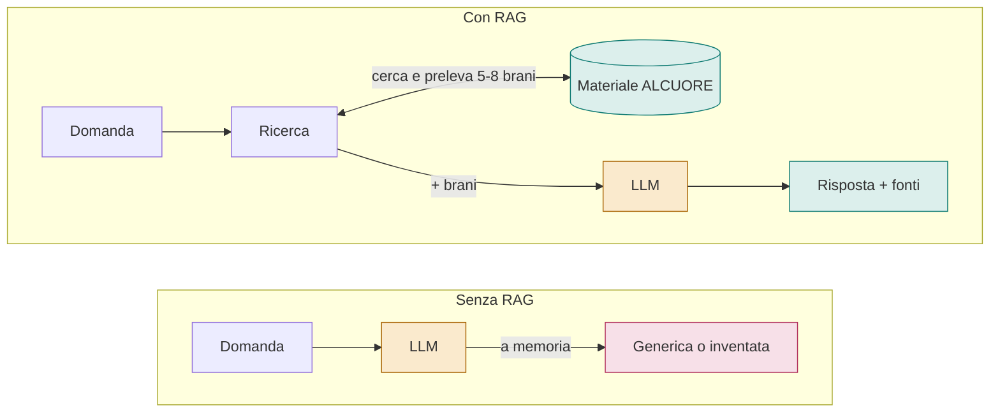

L'unica differenza è il passaggio dalla biblioteca del metodo. Se il manuale cambia, si aggiorna il materiale e il giorno dopo l'AI usa la versione nuova, senza riaddestrare nulla.

> L'alternativa si chiama **fine-tuning**: riaddestrare il modello sui propri testi, come far studiare a memoria. Costa di più, è difficile da correggere e, se fatto sulle conversazioni degli studenti, pone problemi di privacy. Per questo il progetto parte dal RAG.

### Fine-tuning: quando sì e quando no

**Per i contenuti del metodo, no.** Il fine-tuning insegna male i fatti e ogni modifica al manuale richiederebbe un nuovo addestramento. I contenuti restano al RAG.

**Per il comportamento, sì, ma dopo il pilota.** Lo stile del Preparatore (domande socratiche, niente compiti svolti, rispetto delle fasi) si può insegnare con un fine-tuning leggero (LoRA), che permette anche un modello più piccolo ed economico. Il risultato finale è *fine-tuning + RAG*: lo stile dal primo, i contenuti dal secondo.

Condizioni: dialoghi veri approvati dai tutor e raccolti con consenso, un set di valutazione di 100 casi, e il modello addestrato deve battere la versione con solo RAG. Il calcolo costa poco; costa preparare e validare i dati.

| «Abbiamo fatto 1000 cicli» può voler dire | Cosa significa | Giudizio |
|---|---|---|
| 1000 passi di addestramento | Il modello viene corretto 1000 volte su piccoli gruppi di esempi | Normale: ore su una sola GPU |
| 1000 esempi nel dataset | 1000 conversazioni modello | Dataset piccolo ma ragionevole per uno stile |
| 1000 epoche | Rileggere tutto il dataset 1000 volte (di solito se ne fanno 1-5) | Sarebbe un errore: il modello impara a memoria e peggiora |
| 1000 prove di prompt | Istruzioni provate e corrette molte volte | Lavoro serio, ma non è fine-tuning |

> Il numero non dice nulla sulla qualità: conta come è stato valutato. Le domande giuste: su quali dati, come misurate che è migliore del modello di partenza, cosa fate quando cambia il materiale, con quale consenso usate i dati degli studenti.

---

## 4. Cercare per significato

Un **embedding** trasforma un testo in una lista di numeri: la sua posizione su una mappa del significato. Testi che parlano della stessa cosa finiscono vicini anche se usano parole diverse. Cercare significa prendere la posizione della domanda e guardare cosa c'è intorno.

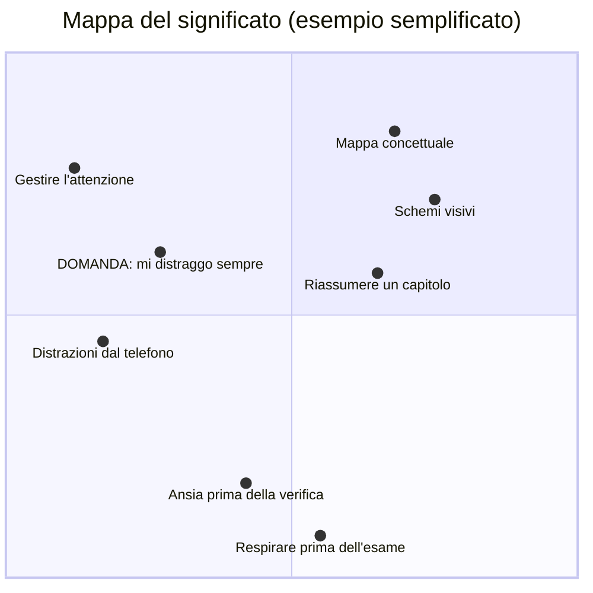

La domanda «mi distraggo sempre» cade vicino alle frasi sull'attenzione: sono quelle che vengono recuperate. In realtà la mappa non ha 2 dimensioni ma centinaia, e le singole direzioni non hanno un significato leggibile: contano solo le distanze. L'idea però è questa: «coordinate GPS del significato».

### Prima di cercare: tagliare il materiale in brani

Il manuale si divide in **chunk**, brani di circa mezza pagina, seguendo i titoli: fase → tecnica → esercizio. Ogni brano porta con sé delle etichette (la fase, il tipo di contenuto, il profilo a cui è adatto), così si può filtrare con certezza invece di sperare che l'AI "capisca" la fase.

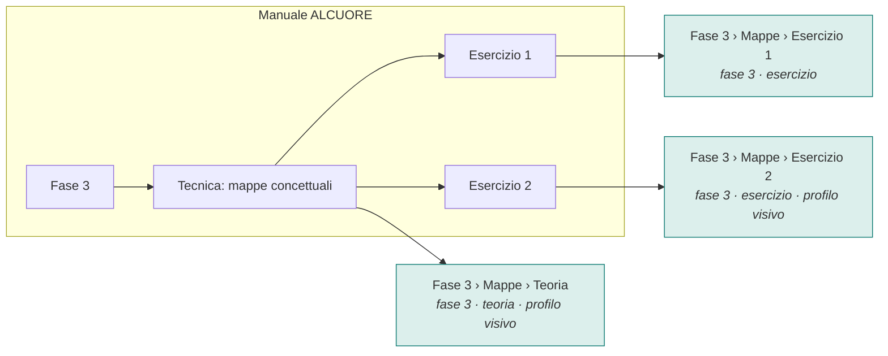

Si recupera il brano piccolo, che è preciso; se serve, all'AI si passa anche la sezione intera da cui viene. La fase è un'etichetta, non qualcosa che l'AI deve indovinare.

### Due ricerche insieme, poi una selezione

La ricerca per significato trova i sinonimi ma può confondere i nomi propri del metodo. La ricerca per parole esatte fa il contrario. Si usano entrambe (**ricerca ibrida**), si uniscono le classifiche e un **reranker** rilegge i candidati per tenere i migliori.

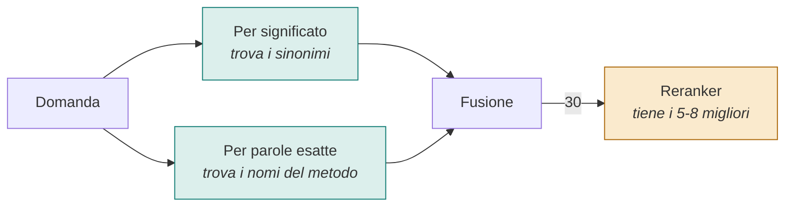

La fusione guarda solo le posizioni in classifica, perché i punteggi delle due ricerche non sono confrontabili. Il reranker è come un secondo lettore che sceglie le schede davvero utili.

---

## 5. Il percorso completo

Il sistema ha due momenti. La **preparazione** si fa una volta, e si ripete solo quando cambia il materiale. La **risposta** avviene a ogni messaggio dello studente.

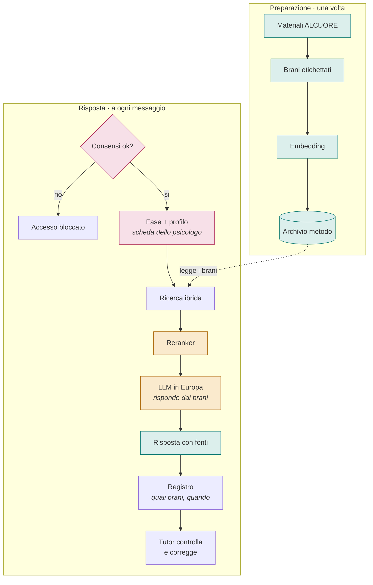

Nella preparazione entra solo il materiale del metodo: nessun dato degli studenti. I dati personali (in rosa) servono solo al momento della risposta, e all'AI arriva solo la scheda descrittiva scritta e approvata dallo psicologo, con un codice al posto del nome. Mai le risposte grezze del test AMOS.

---

## 6. Le scelte di fondo

Queste sono le decisioni su cui si regge il progetto. Per ognuna conta saper dire il perché.

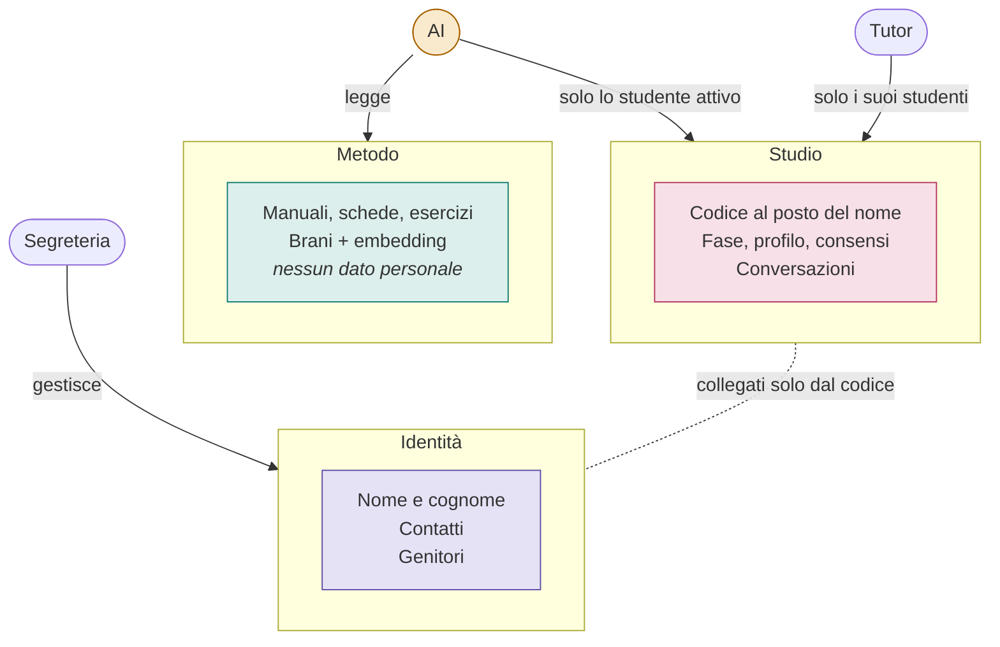

Tre zone con protezioni diverse. L'AI non ha nessuna strada verso nomi e contatti. Anche dentro la zona Studio il database stesso fa vedere a ogni tutor solo i propri studenti, come se ognuno avesse la chiave solo dei propri armadietti.

- **Nei vettori solo il metodo (la decisione più importante).** Gli embedding sembrano numeri anonimi, ma dai numeri si può ricostruire gran parte del testo di partenza. Un embedding di un messaggio dello studente va trattato come il messaggio stesso. Mettendo nei vettori solo il materiale del metodo, la parte tecnologicamente nuova resta fuori dalla zona delicata.
- **Un solo database.** Il numero di vettori dipende dal materiale del metodo, non da quanti studenti ci sono: è un volume piccolo. Basta un database classico (PostgreSQL) con un'estensione per i vettori. Un solo sistema da proteggere, salvare e da cui cancellare.
- **RAG prima, fine-tuning dopo.** Il RAG si aggiorna subito e mostra le fonti. Il fine-tuning si valuta più avanti, e solo con dati raccolti con un consenso apposito.
- **Tutto in Europa.** Modelli open-weight, cioè installabili, su server in UE: sia quello che calcola gli embedding sia l'LLM che scrive. Nessun testo degli studenti esce dall'Europa.
- **Le persone decidono, l'AI esegue.** Il profilo lo costruisce e lo approva lo psicologo; il percorso lo decide il tutor. L'AI legge la scheda come contesto e adatta stile ed esercizi. È un valore per Learnis ed è ciò che tiene il sistema fuori dall'alto rischio.

Perché i vettori non sono anonimi:

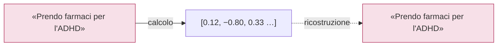

Studi del 2023 hanno ricostruito esattamente la maggior parte di frasi brevi partendo solo dai numeri.

---

## 7. Privacy e regole

Non servono gli articoli a memoria. Servono poche immagini: chi dà il consenso, chi costruisce il profilo, dove si colloca il sistema per l'AI Act e cosa vuol dire cancellare.

### Chi dà il consenso

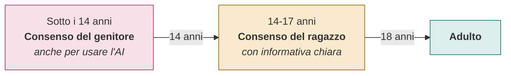

In Italia la soglia è 14 anni. Dal 2025 una legge italiana sull'IA usa la stessa soglia anche per l'accesso agli strumenti di intelligenza artificiale. Il sistema registra chi ha dato il consenso, quando, per quale scopo e su quale testo.

### Chi costruisce il profilo: lo psicologo, non l'AI

È il dettaglio che cambia tutto. Il test AMOS lo interpreta uno psicologo professionista, che scrive e approva una **scheda descrittiva**. L'AI riceve solo quella scheda, come informazione di contesto, e la usa per adattare lo stile delle risposte e gli esercizi proposti. Non analizza le risposte del test e non cataloga lo studente.

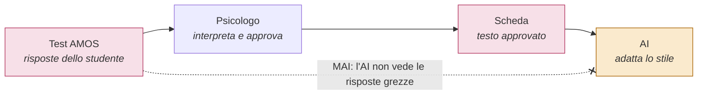

Esempio di scheda: «Lo studente 412 ha difficoltà nella pianificazione del tempo e beneficia di mappe concettuali». Niente nome: nel prompt c'è solo il codice.

### Dove si colloca per l'AI Act

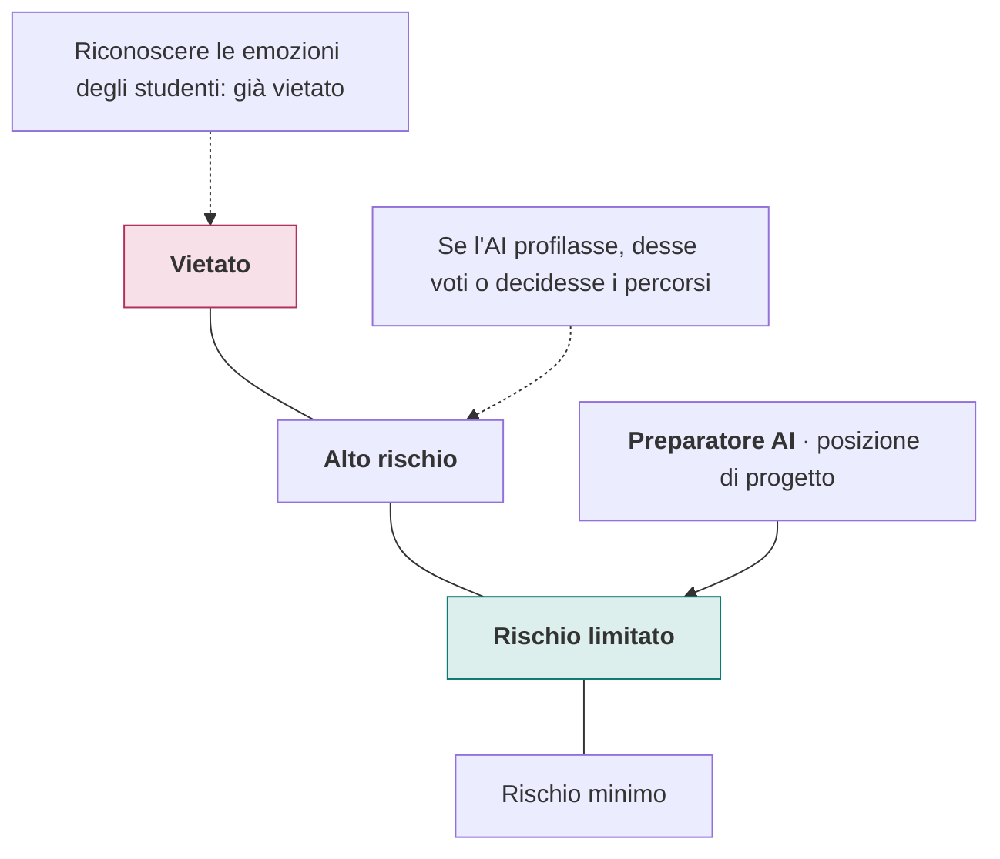

Il sistema non profila da solo, non dà voti, non seleziona e non decide percorsi: per questo è progettato per stare nel rischio limitato. È una posizione da confermare per iscritto con un legale, e regge solo finché valgono le condizioni qui sotto.

**Per restare a rischio limitato, le condizioni da rispettare:**

1. L'AI non profila: riceve la scheda scritta e approvata dallo psicologo.
2. Non assegna voti e non fa selezioni.
3. Non decide il percorso: decide il tutor.
4. Non riconosce né valuta le emozioni.
5. La valutazione del perché non è alto rischio va messa per iscritto prima di partire.

**L'unico obbligo operativo: dire che è un'AI.** L'AI Act chiede trasparenza (art. 50): all'avvio della chat compare un avviso chiaro, per esempio:

> «Questo assistente virtuale usa le indicazioni del tuo tutor e del tuo psicologo di riferimento per aiutarti nello studio. Stai parlando con un'intelligenza artificiale, non con una persona.»

### Cosa vuol dire cancellare

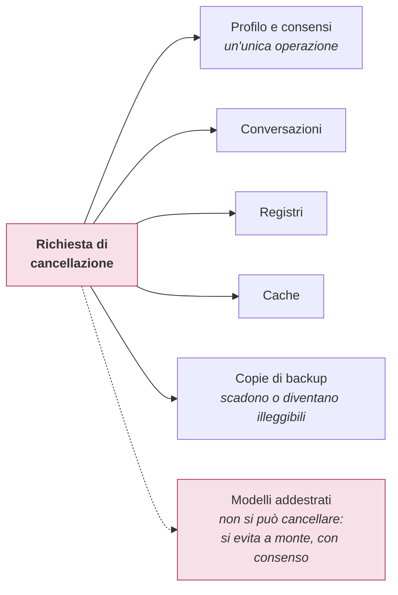

Cancellare deve significare cancellare ovunque, comprese le copie. Il database va progettato perché basti un'operazione sola. Per i modelli riaddestrati non esiste un vero «cancella», quindi le conversazioni si usano per l'addestramento solo con un consenso facoltativo, spento per default.

### Le regole da ricordare

- **Rischio limitato non vuol dire dati leggeri.** L'AI Act guarda cosa fa il sistema; il GDPR guarda i dati. I profili psicometrici e attitudinali restano molto delicati e possono rivelare aspetti della salute: si trattano con la massima protezione.
- **Un consenso specifico per l'AI.** Il modulo privacy firmato per il test AMOS deve contenere una clausola esplicita: i risultati, in forma di scheda, e le indicazioni del tutor vengono usati da un assistente basato su intelligenza artificiale.
- **Nel prompt solo un codice.** Nella scheda passata all'AI non compaiono mai nome, cognome o codice fiscale, ma solo un identificativo interno (per esempio «Studente 412»).
- **Nessun addestramento altrui.** I dati inseriti nei prompt non devono servire ad addestrare i modelli di nessun fornitore. Con un modello open-weight su server in UE è garantito per costruzione; con un servizio esterno va verificato nel contratto e nelle impostazioni.
- **Pseudonimizzare non è anonimizzare.** Un codice al posto del nome riduce il rischio, ma il dato resta personale finché da qualche parte esiste la rubrica che collega codice e persona.
- **DPIA quasi certa.** Minori, profilazione, tecnologia nuova e possibili dati delicati, tutti insieme, rendono necessaria la valutazione d'impatto. La firma il titolare (Learnis); il fornitore porta la descrizione tecnica.
- **Conservare il minimo.** I registri tecnici (quali brani, quando) si tengono per mesi perché servono ai controlli. Il testo completo delle conversazioni per il debug si tiene per giorni o settimane.

> Questa parte non è consulenza legale: ruoli, basi giuridiche e tempi di conservazione si decidono con il DPO di Learnis.

---

## 8. Fonti e copyright

Il RAG funziona bene solo se la biblioteca è buona. Ma non tutto quello che è utile si può caricare: i libri che spiegano il test AMOS, per esempio, sono di un editore e protetti dal diritto d'autore. Ogni fonte va controllata prima di entrare nell'archivio.

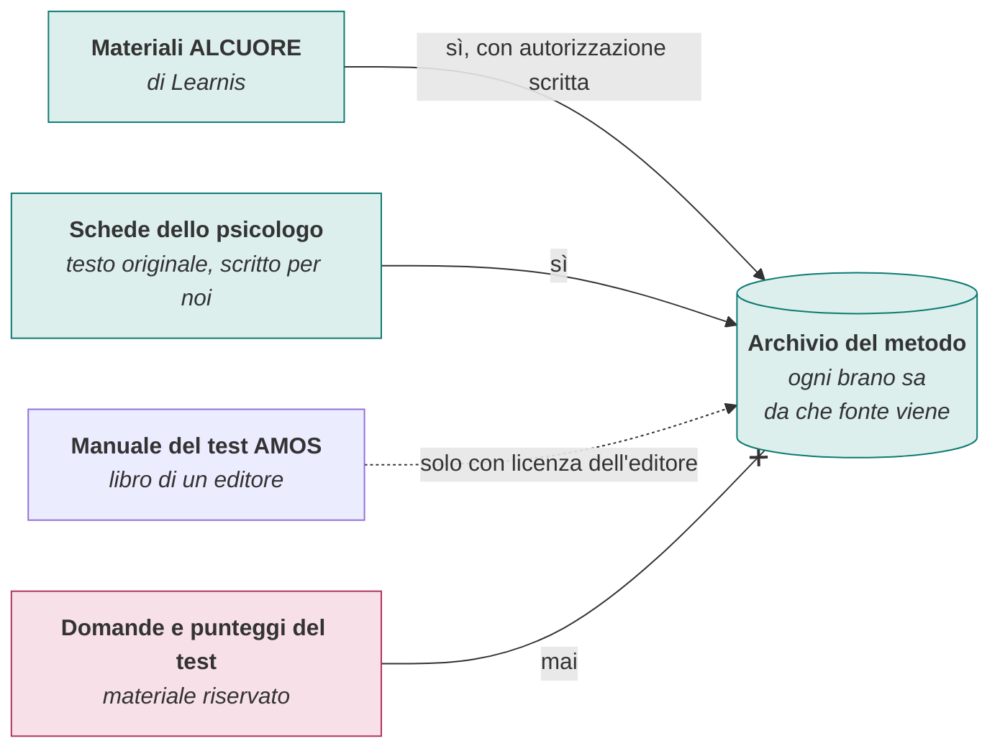

Quattro tipi di fonte, quattro risposte diverse. La strada più semplice per i contenuti del test è la seconda: schede scritte da zero dallo psicologo con parole sue.

- **Comprare il libro non basta.** Avere una copia non dà il diritto di copiarla in un archivio digitale e di farla citare a migliaia di studenti. Le eccezioni per l'analisi automatica dei testi non coprono con sicurezza un archivio che restituisce brani agli utenti.
- **Le idee sono libere, le parole no.** Il diritto d'autore protegge il testo, non i concetti. Una scheda scritta da zero dallo psicologo si può usare; pagine copiate o parafrasate da vicino no.
- **Il test non entra mai nell'AI.** Domande, chiavi di correzione e tabelle dei punteggi sono protette, e se circolassero il test perderebbe valore. L'AI non somministra e non corregge il test.
- **Citare, non riprodurre.** Anche con una licenza, l'assistente riporta brevi passaggi e rimanda alla fonte (titolo, capitolo). Non restituisce pagine intere.
- **Un registro delle fonti.** Per ogni documento: chi ha i diritti, quale licenza, cosa permette, quando scade. Se una licenza scade o viene revocata, i brani di quella fonte si ritirano dall'archivio.
- **Addestrare è un permesso a parte.** Usare un testo per il RAG e usarlo per addestrare un modello sono due usi diversi. La licenza deve dire esplicitamente se l'addestramento è permesso, anche per i materiali di Learnis.

> Anche questa parte va confermata con un legale, insieme al contratto con Learnis che chiarisce chi garantisce i diritti sui materiali forniti.

---

## 9. Cosa può andare storto

La regola da ricordare: **quando il RAG sbaglia, di solito è colpa del recupero**, non dell'LLM. Per questo ogni risposta registra quali brani ha usato.

| Sintomo | Perché succede | Rimedio |
|---|---|---|
| Risposta generica o sbagliata | Ha recuperato i brani sbagliati | Controllare il registro e testare la ricerca con domande reali |
| Inventa una «fase 8» | Non si attiene alle fonti | Istruzioni rigide: «rispondi solo dai brani e citali» |
| Qualità crollata dopo un aggiornamento | Sono stati mescolati due modelli di embedding: nessun errore visibile, solo risultati sbagliati | Registrare sempre quale modello ha calcolato ogni vettore |
| Il brano giusto c'era ma è stato ignorato | Troppo testo: gli LLM «perdono» quello che sta in mezzo | Pochi brani ma buoni, i migliori in testa |
| Qualcuno prova a ingannare l'AI | Prompt injection: istruzioni nascoste nei messaggi | Il database stesso nega i dati altrui, qualunque cosa chieda l'AI |

### Come si misura la qualità

I tutor scrivono un centinaio di domande realistiche, circa 14 per fase, indicando il brano giusto. Poi si controllano due cose separate:

- **Ricerca:** il brano giusto compare tra i primi 5 trovati?
- **Risposta:** quello che l'AI afferma è sostenuto dai brani? Si chiama *faithfulness*, fedeltà alle fonti.

Nell'uso quotidiano si aggiungono le segnalazioni dei tutor: corretto, impreciso, inventato, fuori tema.

---

## 10. Verifica di aver capito

Rispondi a voce, poi apri la risposta.

Che differenza c'è tra RAG e fine-tuning?

Il RAG è l'esame a libro aperto: a ogni domanda il sistema consulta il materiale. Il fine-tuning è studiare a memoria, cioè riaddestrare il modello. Il RAG è più facile da aggiornare e da controllare.

Cos'è un embedding, in una frase?

La posizione di un testo su una mappa del significato: testi simili stanno vicini anche se usano parole diverse.

Perché si tagliano i materiali in brani seguendo i titoli?

Perché così ogni brano parla di una cosa sola e porta con sé le etichette giuste (fase, tecnica, profilo), che permettono di filtrare con certezza.

Perché serve anche la ricerca per parole esatte?

Per i nomi propri del metodo (fasi, tecniche, sigle), che la ricerca per significato può confondere.

Cosa fa il reranker?

Rilegge i circa 30 candidati trovati dalle due ricerche e tiene i 5-8 più utili da passare all'LLM.

Perché nei vettori non mettiamo i dati degli studenti?

Perché dai vettori si può ricostruire il testo: sarebbero comunque dati personali, ma in un posto più difficile da proteggere.

Uno studente di 13 anni vuole usare il tutor: cosa serve?

Il consenso del genitore, registrato con data, scopo e modo in cui è stato verificato.

Perché Preparatore AI è progettato per il rischio limitato?

Perché l'AI non profila: il profilo lo costruisce e lo approva lo psicologo, e l'AI lo riceve solo come contesto. Inoltre non dà voti, non seleziona e non decide percorsi. Va confermato per iscritto con un legale.

Cosa chiede l'AI Act in questo caso?

Trasparenza: un avviso chiaro che lo studente sta parlando con un'AI. Resta vietato riconoscere le emozioni degli studenti. Il GDPR invece continua a chiedere la massima protezione per i dati psicometrici.

Possiamo caricare nell'archivio il manuale del test AMOS?

Solo con una licenza dell'editore. In alternativa si usano schede scritte da zero dallo psicologo. Domande e punteggi del test non entrano mai.

Se l'AI risponde male, cosa controlli per primo?

Quali brani ha recuperato: nella maggior parte dei casi l'errore nasce nella ricerca, non nella scrittura della risposta.

Un concorrente dice di aver fatto «1000 cicli» di addestramento: cosa chiedi?

Su quali dati, come misurano che il modello addestrato è migliore di quello di partenza, cosa fanno quando cambia il materiale e con quale consenso usano i dati degli studenti. Il numero da solo non dice nulla sulla qualità.

---

*Versione semplificata del documento tecnico «Progettare il database di Preparatore AI: vettori, RAG e GDPR».*
