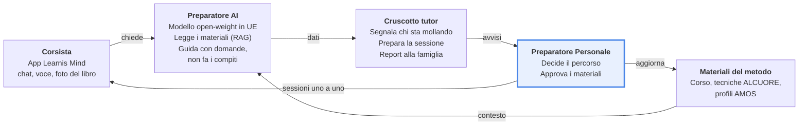
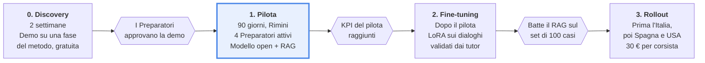

<!-- INIZIO GUIDA ALLA REVISIONE · da cancellare quando hai finito -->

# Revisione della proposta Learnis

Questo file è una copia completa di `README.md`. Ogni modifica che propongo compare nel punto esatto in cui va fatta, come un conflitto di git merge:

```
<<<<<<< ATTUALE (ID · sezione)
il testo com'è oggi nel README
=======
il testo che propongo
>>>>>>> PROPOSTA ID · categoria · gravità · motivo in una riga
```

**Come usarlo.** Aprilo in VS Code: sopra ogni blocco compaiono i pulsanti *Accept Current Change* (tieni il README) e *Accept Incoming Change* (accetta la proposta), oppure *Accept Both*. Quando non resta nessun blocco, cancella questa guida e copia il file sopra `README.md`. Se una proposta di inserimento ha la parte ATTUALE vuota, accettare ATTUALE significa non aggiungere nulla.

**Le proposte.** Sono 28: 10 di gravità alta, 13 media, 5 bassa. 7 sono marcate DA DECIDERE perché cambiano prezzo, garanzia, nomi o valori: lì serve una tua scelta, non solo una correzione. Le categorie sono:
- **Coerenza:** parti della proposta che si contraddicono. La più importante: le sezioni I e II mettono al centro le vendite, la sezione III ragiona ancora quasi solo sull'uso del corsista e sull'integrazione nell'app, che nel pilota non c'è.
- **Calcolo:** numeri da aggiornare o che non tornano. I calcoli esistenti li ho rifatti tutti e sono corretti (12 × 2.800 = 33.600 €; × 33 = 1.108.800 €; stack = 53.000 €; tutor da 10 a 15 €/h; 25–30 persone in demo in 90 giorni; 30 € ≈ 1% del corso).
- **Fonte:** cosa dicono davvero le pagine citate, verificate il 12 ottobre 2026.
- **Hormozi:** leve del libro usate poco o non usate.
- **Stile:** forma.

**Fonti verificate e confermate senza modifiche:** comunicato Newswire dell'8 settembre 2026 (struttura, persone, oltre 50 centri, oltre 5.000 partecipanti, CNR-IRPI SaperCapire, codice etico 2024, garante etico, testimonianze certificate); App Store (Dieffetech, copyright Genio Net, «Data Not Collected»); Orizzonte Scuola sulla Legge 132/2025, art. 4 comma 4 (sotto i 14 anni serve chi esercita la responsabilità genitoriale; dai 14 il consenso è valido se le informazioni sono comprensibili); presentazione Genio Net (ALCUORE, AMOS, Preparatore Personale, supervisione di Riccardo Venturini).

**Fuori dal README.** Il libro non indica un ordine con cui presentare l'offerta al cliente: la presentazione HTML segue quindi un ordine di vendita (dolore → risultato → offerta → prezzo → garanzia → scadenza), non quello dei capitoli. Hormozi ripete «il dolore è la presentazione» (cap. 4): la prima slide dopo la copertina è il problema di Learnis, con i loro numeri.

## Indice delle proposte

| ID | Sezione | Categoria | Gravità | Da decidere | Motivo |
|---|---|---|---|---|---|
| R-01 | Sintesi | Fonte | Bassa |  | Molti numeri vengono dalle risposte di Learnis, non da fonti pubbliche |
| R-02 | I · Learnis oggi | Fonte | Bassa |  | L'elenco sul sito conta 27 città distinte, non 26 come dichiara la pagina |
| R-03 | I · Learnis oggi | Fonte | Bassa |  | Esplicitare l'acrostico ALCUORE e il nome AMOS rende la proposta più credibile |
| R-04 | I · Learnis oggi | Fonte | Media |  | La pagina dice che gli esercizi girano soprattutto su ChatGPT e Claude è in introduzione; sotto i 16 anni partecipa un genitore |
| R-05 | II · introduzione | Coerenza | Media |  | Il problema n.1 dichiarato da Learnis è acquisire corsisti: va detto nella frase che apre il prezzo |
| R-06 | II.1 Fuori dalla commodity | Hormozi | Media |  | Cap. 6, «il veloce batte il gratis»: è la risposta diretta alla minaccia dell'assistente gratuito |
| R-07 | II.2 Mercato e avatar | Coerenza | Bassa |  | «Rete USA solo online» non è un dolore; manca il dato più forte, cioè le poche persone in demo |
| R-08 | II.3 Prezzo e modello monetario | Hormozi | Alta | sì | Cap. 5: 30 € sono circa l'1% del valore di un corsista; legare una parte del rollout all'aumento di iscrizioni |
| R-09 | III.1 Equazione del Valore | Coerenza | Alta |  | Il risultato da sogno della direzione non nomina il problema n.1 (acquisire corsisti); i follow-up sono inclusi nel corso, non si vendono |
| R-10 | III.1 Equazione del Valore | Coerenza | Alta |  | Nel pilota non c'è integrazione nell'app (V.1 dice web app separata): «niente nuova app» e «nell'app esistente» non sono veri |
| R-11 | III.3 I mattoni | Coerenza | Media |  | La prova gratuita e il kit demo, cioè le leve sul problema n.1, mancano dai mattoni |
| R-12 | III.4 Problemi → soluzioni | Coerenza | Alta |  | La tabella non contiene nessun problema di vendita, che è il problema n.1 dichiarato da Learnis |
| R-13 | III.4 Problemi → soluzioni | Coerenza | Alta |  | Contraddice II.3: il valore per Learnis ora sta nelle vendite, il tempo del tutor non è un costo per Learnis |
| R-14 | III.4 Problemi → soluzioni | Coerenza | Media |  | Stessa incoerenza di R-10: nel pilota non è integrato nell'app |
| R-15 | III.5 Taglia e accumula | Coerenza | Media |  | «Chat e voce nell'app» e «tagliamo un'app nuova separata» contraddicono V.1, dove il pilota è proprio una web app separata |
| R-16 | III.5 Lo stack finale | Coerenza | Alta | sì | La prova gratuita risolve il problema n.1 e va nel cuore dell'offerta, non tra i bonus; il Preparatore AI nel pilota non è integrato |
| R-17 | III.5 Lo stack finale | Calcolo | Alta | sì | Il totale va aggiornato se si accetta R-16 (53.000 + 8.000) |
| R-18 | IV.3 Urgenza | Hormozi | Media |  | Le date del pilota non tornano (90 giorni da gennaio finiscono ad aprile) e manca la scadenza reale per chi decide oggi |
| R-19 | IV.3 Urgenza | Fonte | Alta |  | Il rinvio non è più una proposta: il Digital Omnibus è il Regolamento (UE) 2026/1744, in vigore dal 27 luglio 2026 |
| R-20 | IV.4 Bonus | Hormozi | Media | sì | Cap. 14: i bonus vanno valorizzati in € e insieme devono superare il valore dell'offerta; il dataset è già nello stack, qui era contato due volte |
| R-21 | IV.5 Garanzia | Coerenza | Alta | sì | I follow-up sono inclusi nel corso, quindi non esistono «ricavi dei follow-up»; e non è chiaro cosa succede se i KPI arrivano nei 30 giorni extra |
| R-22 | IV.5 Garanzia | Hormozi | Alta | sì | Cap. 15: una garanzia condizionata senza numeri non toglie rischio; soglie di partenza da negoziare in discovery |
| R-23 | IV.6 Nome MAGIC | Coerenza | Media | sì | «Il doppio dei corsisti» non ha numeri a sostegno; «Learnis Mind Companion» promette un'integrazione che nel pilota non c'è; manca un nome per la prova gratuita, il magnete vero |
| R-24 | V.1 Architettura | Fonte | Media |  | L'App Store dice che l'app è accessibile solo agli iscritti: la prova gratuita per i non iscritti deve comunque stare fuori |
| R-25 | V.5 Prossimi passi | Coerenza | Media |  | La Sezione VI è già in gran parte compilata; il prototipo ha una prima bozza; mancano le soglie dei KPI |
| R-26 | VI · Domande aperte | Calcolo | Media |  | I conti non tornano (meno di 2 nuovi al mese ma 10–15 seguiti) e Hormozi ragiona sul profitto lordo, non sul prezzo (cap. 3) |
| R-27 | Fonti | Fonte | Media |  | Aggiunge la fonte sul Digital Omnibus usata in R-19 |
| R-28 | Fonti | Stile | Bassa |  | Se il documento va al cliente, si cita il libro originale, non il file di studio nella repo |

<!-- FINE GUIDA ALLA REVISIONE -->

# Proposta Learnis — Tutor AI affiancato

*11 ottobre 2026 · Proponente: [Proponente]*

## Sintesi

Proponiamo a Learnis un Preparatore AI addestrato sul loro metodo che aiuta a vendere più corsi, accompagna il corsista tra una sessione e l'altra e toglie al tutor gran parte dell'ora di preparazione. Non sostituisce il Preparatore Personale: ne moltiplica la portata e rende visibile il progresso a famiglie e corsisti.

<<<<<<< ATTUALE (R-01 · Sintesi)
La proposta segue passo passo *$100M Offers* di Alex Hormozi: ogni sezione qui sotto corrisponde a un capitolo del libro e risponde alla stessa domanda. I numeri su Learnis vengono da fonti pubbliche; prezzi e KPI sono ipotesi da validare in discovery e sono marcati come tali. Il proponente è indicato come [Proponente].
=======
La proposta segue passo passo *$100M Offers* di Alex Hormozi: ogni sezione qui sotto corrisponde a un capitolo del libro e risponde alla stessa domanda. I numeri su Learnis vengono da fonti pubbliche e dalle prime risposte di Learnis (Sezione VI); prezzi e KPI sono ipotesi da validare in discovery e sono marcati come tali. Il proponente è indicato come [Proponente].
>>>>>>> PROPOSTA R-01 · Fonte · Bassa · Molti numeri vengono dalle risposte di Learnis, non da fonti pubbliche

| Capitolo del libro | Sezione della proposta | Domanda a cui risponde |
|---|---|---|
| 1–2. Come siamo arrivati qui · Offerte Grand Slam | I. Contesto e offerta in una frase | Perché Learnis, perché ora, cosa offriamo |
| 3. Il problema delle commodity | II.1 Fuori dalla commodity | Cosa non vendiamo e perché |
| 4. La folla affamata | II.2 Mercato e avatar | Dolore, potere d'acquisto, target, crescita |
| 5. Fatti pagare quanto vale | II.3 Prezzo e modello monetario | Quanto chiediamo e come incassiamo |
| 6. Equazione del Valore | III.1 I quattro driver | Sogno, probabilità, tempo, sforzo |
| 7. Free Goodwill | III.2 Valore prima della firma | Cosa diamo gratis per primi |
| 8. Processo di pensiero | III.3 I mattoni | Con quali componenti costruiamo |
| 9. Problemi e soluzioni | III.4 Problemi → soluzioni | Ogni ostacolo ribaltato |
| 10. Taglia e accumula | III.5 Lo stack finale | Cosa teniamo, cosa togliamo |
| 11. Danza del desiderio | IV.1 Strategia di lancio | Come gestiamo la domanda |
| 12–13. Scarsità · Urgenza | IV.2–IV.3 | Limiti reali e scadenze reali |
| 14. Bonus | IV.4 | Cosa aggiungiamo senza scontare |
| 15. Garanzie | IV.5 | Come togliamo il rischio a Learnis |
| 16. Naming | IV.6 Nome MAGIC | Come si chiama l'offerta |
| 17. Esecuzione | V. Architettura, roadmap, prossimi passi | Come lo facciamo accadere |

---

## I. Come siamo arrivati qui

Learnis è nata l'8 settembre 2026 riunendo sotto un unico marchio le società che da quasi 20 anni condividono il metodo Genio in 21 Giorni ([comunicato](https://www.newswire.com/news/learnis-a-new-international-network-for-transformative-education-is-born)). Il momento è ideale: stanno rifacendo sistemi, contenuti e certificazioni, quindi uno strato AI entra nell'architettura nuova invece di essere incollato su quella vecchia.

### Learnis oggi (dati pubblici)

| Elemento | Dato | Fonte |
|---|---|---|
| Struttura | Rete di società indipendenti in Italia (Genio Net), Spagna (Crecimiento Personal) e USA (Genius in 21 Days LLC) | [comunicato](https://www.newswire.com/news/learnis-a-new-international-network-for-transformative-education-is-born) |
| Persone chiave | Massimo De Donno (Presidente Learnis Italia), Giacomo Navone (Presidente Learnis España), Stephanie Turconi e Cosimo Intermite (USA) | [comunicato](https://www.newswire.com/news/learnis-a-new-international-network-for-transformative-education-is-born) |
| Scala | Oltre 50 centri, oltre 5.000 partecipanti l'anno | [comunicato](https://www.newswire.com/news/learnis-a-new-international-network-for-transformative-education-is-born) |
<<<<<<< ATTUALE (R-02 · I · Learnis oggi)
| Rete in Italia | 33 centri in 26 città, di cui 4 solo online | [sito Learnis](https://www.learnis.org/global-presence/italy/centres/) |
=======
| Rete in Italia | 33 centri, di cui 4 solo online; il sito dichiara 26 città, ma dall'elenco ne risultano 27 | [sito Learnis](https://www.learnis.org/global-presence/italy/centres/) |
>>>>>>> PROPOSTA R-02 · Fonte · Bassa · L'elenco sul sito conta 27 città distinte, non 26 come dichiara la pagina
<<<<<<< ATTUALE (R-03 · I · Learnis oggi)
| Metodo | Metodo di studio personalizzato sul profilo cognitivo, processo in sette fasi (ALCUORE), profilazione con questionari AMOS | [presentazione Genio Net](https://ordineavvocatimilano.it/media/convenzioni/GENIO%20NET/Presentazione%20Genio%20in%2021%20Giorni-1.pdf) |
=======
| Metodo | Metodo di studio personalizzato sul profilo cognitivo, in sette fasi ALCUORE (Approccio, Lettura, Comprensione, Unire i puntini, Organizzazione, Ricordo, Esposizione), profilazione con i questionari AMOS (Abilità e Motivazione allo Studio) | [presentazione Genio Net](https://ordineavvocatimilano.it/media/convenzioni/GENIO%20NET/Presentazione%20Genio%20in%2021%20Giorni-1.pdf) |
>>>>>>> PROPOSTA R-03 · Fonte · Bassa · Esplicitare l'acrostico ALCUORE e il nome AMOS rende la proposta più credibile
| Ricerca | Modulo C1 di Learnis Mind erogato dal gruppo SaperCapire del CNR-IRPI | [comunicato](https://www.newswire.com/news/learnis-a-new-international-network-for-transformative-education-is-born) |
| Figura umana | Preparatore Personale: profila il corsista e costruisce il percorso su misura | [presentazione Genio Net](https://ordineavvocatimilano.it/media/convenzioni/GENIO%20NET/Presentazione%20Genio%20in%2021%20Giorni-1.pdf) |
| Digitale esistente | App Learnis Mind (Dieffetech): obiettivi, ripassi pianificati, video tutorial, sfide, contatto col coach | [App Store](https://apps.apple.com/us/app/id1463606211) |
<<<<<<< ATTUALE (R-04 · I · Learnis oggi)
| Offerta AI attuale | LEARNIS AI Study: corso di 8 ore in 2 giorni, dagli 11 anni, su ChatGPT e Claude, 97 € (listino 197 €), circa 2 ore di presentazione di Learnis Mind, nessun seguito | [sito Learnis](https://www.learnis.org/formative-offer/learning-skills/learnis-ai-study/) |
=======
| Offerta AI attuale | LEARNIS AI Study: corso di 8 ore in 2 giorni, dagli 11 anni (sotto i 16 con un genitore), per ora soprattutto su ChatGPT con Claude in introduzione, 97 € (listino 197 €), circa 2 ore di presentazione di Learnis Mind, nessun seguito | [sito Learnis](https://www.learnis.org/formative-offer/learning-skills/learnis-ai-study/) |
>>>>>>> PROPOSTA R-04 · Fonte · Media · La pagina dice che gli esercizi girano soprattutto su ChatGPT e Claude è in introduzione; sotto i 16 anni partecipa un genitore
| Fiducia | Codice etico dal 2024, garante etico per paese, testimonianze certificate | [comunicato](https://www.newswire.com/news/learnis-a-new-international-network-for-transformative-education-is-born) |

### Il varco che vediamo

Ogni corsista fa le 8 ore di follow-up incluse nel corso. Per ogni ora di sessione il tutor ne passa un'altra a prepararsi, in una sessione di formazione non pagata, affiancato da un istruttore esperto. Dopo 90 giorni ben meno del 5% dei corsisti usa ancora l'app Learnis Mind, e il corso StudIA ha dato risultati molto deludenti.

Il problema principale però è acquisire nuovi corsisti. A Rimini meno di 10 persone al mese arrivano in demo e ne compra circa il 20%, cioè meno di 2 nuovi corsisti al mese. Learnis sta puntando sui social e vuole aggiungere demo online a quelle in sede.

### L'offerta Grand Slam in una frase

Un Preparatore AI sul metodo Learnis che le famiglie possono provare prima di comprare, che accompagna il corsista ogni sera e che riduce a pochi minuti la preparazione non pagata del tutor. Pilota di 90 giorni a Rimini e nelle demo online, metà del compenso legata ai risultati.

---

## II. Prezzo

<<<<<<< ATTUALE (R-05 · II · introduzione)
Non vendiamo ore di sviluppo né un chatbot: vendiamo più corsisti che applicano il metodo, a parità di tutor. Il prezzo si lega a quel risultato, non al costo del software.
=======
Non vendiamo ore di sviluppo né un chatbot: vendiamo più iscritti dalle stesse demo e più corsisti che applicano il metodo, a parità di tutor. Il prezzo si lega a quel risultato, non al costo del software.
>>>>>>> PROPOSTA R-05 · Coerenza · Media · Il problema n.1 dichiarato da Learnis è acquisire corsisti: va detto nella frase che apre il prezzo

### II.1 Fuori dalla commodity (cap. 3)

Se Learnis ci confronta con un fornitore di chatbot o con un abbonamento a un assistente generico, perdiamo sul prezzo. Dobbiamo stare in una categoria di uno.

| | Offerta commodity | Offerta Grand Slam |
|---|---|---|
| Cosa compra Learnis | Un chatbot sviluppato a giornata | Un Preparatore AI che parla il metodo Learnis |
| Contenuto | Modello generico con un prompt | Addestrato su materiali, linguaggio e casi del metodo, validato dai loro Preparatori |
| Rapporto col tutor | Alternativo al tutor | Al servizio del tutor: cruscotto, segnalazioni, proposte di intervento |
| Rischio | Tutto su Learnis | Pilota a risultati, garanzia condizionata |
| Confronto possibile | Con qualsiasi software house o con un assistente gratuito | Nessuno: è l'unico costruito sul loro metodo e sui loro dati |

La minaccia vera per Learnis è che un assistente generico gratuito faccia sembrare superfluo un metodo di studio. La nostra offerta la ribalta: l'AI diventa il veicolo del metodo, non il suo sostituto.
<<<<<<< ATTUALE (R-06 · II.1 Fuori dalla commodity)
=======

Contro il gratis si vince con la velocità: come scrive Hormozi, l'unica cosa che batte il gratis è il veloce. L'assistente generico è gratuito, ma lascia al ragazzo il lavoro di capire cosa chiedere; il nostro lo porta al risultato del metodo in pochi minuti, senza dover imparare a scrivere prompt.
>>>>>>> PROPOSTA R-06 · Hormozi · Media · Cap. 6, «il veloce batte il gratis»: è la risposta diretta alla minaccia dell'assistente gratuito

Con cosa ci confronterà Learnis:

| Alternativa | Cosa offre | Perché la nostra è diversa |
|---|---|---|
| Assistente generico gratuito | Risponde a tutto, non conosce il metodo | Lavora sul metodo e sul profilo del corsista, dentro il flusso del tutor |
| LEARNIS AI Study (nuova versione di StudIA, mai ancora erogata) | Corso da 97 € che insegna a usare ChatGPT e Claude per studiare | Non lo sostituisce: può diventarne il seguito, cioè proprio ciò che è mancato a StudIA |
| Strumento dell'ex collaboratore | Verifica della comprensione per la formazione aziendale, orizzontale, percentuale a Learnis sui clienti procacciati | Il nostro è verticale sul metodo, sui corsisti di Learnis, e il dataset resta di Learnis |

Il fallimento di StudIA è l'obiezione numero uno e va affrontato per primo nella presentazione. Le sue cause sono note, e l'offerta risponde a ognuna:

| Causa del fallimento di StudIA | Come la evitiamo |
|---|---|
| Promesse eccessive | Promettiamo solo KPI misurabili, con garanzia condizionata |
| Nessun seguito dopo il corso | Il sistema vive dentro le 8 ore di follow-up, che fanno tutti i corsisti |
| Nato già vecchio | Modelli recenti, materiali aggiornabili senza riaddestrare, confronto periodico tra modelli |
| Era un pretesto per presentare il corso a esterni | Progetto a sé, con responsabile, budget e KPI propri |

### II.2 Mercato e avatar (cap. 4)

Learnis è una folla affamata su tutti e quattro gli indicatori del libro.

| Indicatore | Learnis | Valutazione |
|---|---|---|
<<<<<<< ATTUALE (R-07 · II.2 Mercato e avatar)
| Dolore | Fatica ad acquisire nuovi corsisti, ore di preparazione dei tutor, calo di pratica dopo il corso, rete USA solo online, pressione degli assistenti AI gratuiti | Alto |
=======
| Dolore | Fatica ad acquisire nuovi corsisti (a Rimini meno di 10 persone al mese in demo, 20% di conversione), ore di preparazione non pagate dei tutor, calo di pratica dopo il corso, pressione degli assistenti AI gratuiti | Alto |
>>>>>>> PROPOSTA R-07 · Coerenza · Bassa · «Rete USA solo online» non è un dolore; manca il dato più forte, cioè le poche persone in demo
| Potere d'acquisto | Rete di oltre 50 centri e oltre 5.000 partecipanti l'anno, già abituata a vendere percorsi premium | Buono, da verificare il budget |
| Facile da raggiungere | Un solo centro decisionale per paese, persone note per nome | Alto |
| In crescita | Nuovo marchio, espansione internazionale tramite Senior Partner | Alto |

Nicchia del pilota: corsisti di scuola superiore dai 14 anni in su, in Italia, nelle settimane dopo il corso, seguiti da un Preparatore Personale. Dai 14 anni il minore può dare il consenso da solo all'uso dell'AI; sotto i 14 serve quello dei genitori ([Legge 132/2025, art. 4](https://www.orizzontescuola.it/intelligenza-artificiale-il-consenso-dei-minore-e-valido-dai-14-anni-in-su-prima-spetta-ai-genitori/)). Partire da qui semplifica il pilota; universitari, adulti e mercato USA vengono dopo. Learnis Italia sceglie la tecnologia, e alcuni centri possono avviare progetti in anteprima: il primo candidato è Rimini, con 4 Preparatori attivi e 10–15 corsisti al mese.

### II.3 Prezzo e modello monetario (cap. 5)

Il prezzo è una frazione del valore generato, e una parte la incassiamo solo se il valore arriva. Tutte le cifre sono ipotesi da validare.

| Fase | Cosa include | Prezzo (ipotesi) |
|---|---|---|
| 0. Discovery e prototipo | Due settimane, demo su una fase del metodo con 2–3 Preparatori | Gratuita |
| 1. Pilota 90 giorni | Centro di Rimini, 4 Preparatori attivi e i loro corsisti; costruzione, formazione, misurazione | 12.000 € fissi, più 12.000 € solo se i KPI sono raggiunti |
<<<<<<< ATTUALE (R-08 · II.3 Prezzo e modello monetario)
| 2. Rollout | Tutti i centri di un paese | 30 € per ogni corsista che entra nel follow-up |
=======
| 2. Rollout | Tutti i centri di un paese | 30 € per ogni corsista che entra nel follow-up, più 150 € per ogni iscrizione in più rispetto alla base misurata nel pilota |
>>>>>>> PROPOSTA R-08 · Hormozi · Alta · DA DECIDERE · Cap. 5: 30 € sono circa l'1% del valore di un corsista; legare una parte del rollout all'aumento di iscrizioni

Il valore per Learnis sta nelle vendite: ogni corsista in più vale un corso da 2.800–3.500 €. Il tempo di preparazione liberato è dei tutor, perché non è pagato: per Learnis conta come motivazione e permanenza dei tutor, non come risparmio.

$$
\text{Valore annuo} = \text{sedi} \times 12 \times \text{corsisti in più al mese per sede} \times \text{prezzo del corso}
$$

| Voce | Valore | Origine |
|---|---|---|
| Centri in Italia | 33, di cui 4 solo online | [Sito Learnis](https://www.learnis.org/global-presence/italy/centres/) |
| Persone in demo a Rimini | Meno di 10 al mese, in circa 3 demo | Learnis |
| Conversione delle demo | Circa 20% | Learnis |
| Nuovi corsisti a Rimini | Meno di 2 al mese | 10 × 20% |
| Prezzo del corso | 3.500 €, 2.800 € se acquistato in demo | Learnis |
| Un corsista in più al mese per sede | Circa 33.600 € l'anno per sede | 12 × 2.800 € |
| Stessa crescita su 33 sedi | Circa 1,1 milioni € l'anno | Ipotesi: richiede che funzioni in tutte le sedi |
| Canone di rollout per corsista | 30 € | Circa l'1% del prezzo del corso |

Il Preparatore AI aiuta le vendite in tre punti. Sui social, una prova gratuita porta persone alle demo online che Learnis sta avviando. In demo, la famiglia lo vede lavorare su un compito vero del figlio. Nell'offerta del corso, accorcia l'attesa del risultato e alza la fiducia di riuscire. Portare Rimini dal 20% al 30% di conversione con 10 persone in demo significa un corso in più al mese.

Per tutor e istruttore il valore è diverso ma reale. Oggi un'ora di sessione pagata 20 € ne richiede un'altra di preparazione non pagata, quindi il tutor guadagna di fatto 10 € l'ora; se la preparazione scende a 20 minuti, sale a 15 € senza che Learnis spenda di più. A Rimini lavorano 4 tutor su 6, ed è un argomento per tenerli attivi.

L'istruttore che affianca i tutor ha poco tempo libero ed è pagato in base agli iscritti. Ogni ora di affiancamento che il copilota gli toglie è un'ora che può spendere su demo e vendite, dove guadagna lui e guadagna Learnis. È il primo alleato da coinvolgere nel pilota.

Il pilota a Rimini da solo non può dimostrare la conversione: in 90 giorni passano circa 25–30 persone in demo e 5–6 nuovi corsisti, troppo pochi per misurare un cambiamento. Per questo i 12.000 € a risultato si legano a indicatori misurabili in 90 giorni (Sezione IV.5). La conversione si misura su 6 mesi, includendo le demo online, ed entra nel prezzo del rollout.

---

## III. Valore

Il valore sta soprattutto nel denominatore dell'equazione: il corsista ha un aiuto immediato a casa, il tutor non deve fare più fatica. Promettere risultati più grandi è facile da copiare; azzerare attesa e sforzo no.

### III.1 L'Equazione del Valore applicata (cap. 6)

$$
\text{Valore} = \frac{\text{Risultato da sogno} \times \text{Probabilità percepita}}{\text{Ritardo temporale} \times \text{Sforzo e sacrificio}}
$$

| Driver | Domanda nella testa | Per la direzione Learnis | Per corsista e famiglia | Leva concreta |
|---|---|---|---|---|
<<<<<<< ATTUALE (R-09 · III.1 Equazione del Valore)
| Risultato da sogno ↑ | Cosa ci guadagno? | Ogni corsista applica il metodo dopo il corso; più follow-up venduti; marchio all'avanguardia | Studiare meno ore con voti migliori, sentirsi capace | Obiettivi personali nell'app, report di progresso |
=======
| Risultato da sogno ↑ | Cosa ci guadagno? | Più iscritti dalle stesse demo; ogni corsista applica il metodo dopo il corso; marchio all'avanguardia | Studiare meno ore con voti migliori, sentirsi capace | Prova gratuita che porta in demo, obiettivi personali, report di progresso |
>>>>>>> PROPOSTA R-09 · Coerenza · Alta · Il risultato da sogno della direzione non nomina il problema n.1 (acquisire corsisti); i follow-up sono inclusi nel corso, non si vendono
| Probabilità ↑ | Come so che funziona? | KPI misurati nel pilota, garanzia, tutor sempre al comando | Il tutor vede e interviene se si blocca | Cruscotto tutor, segnalazioni, testimonianze certificate |
<<<<<<< ATTUALE (R-10 · III.1 Equazione del Valore)
| Ritardo ↓ | Quanto ci vuole? | Prototipo in 2 settimane, pilota in 90 giorni | Risposta in pochi secondi, anche alle 22 | Assistente sempre disponibile nell'app esistente |
| Sforzo ↓ | Cosa mi chiedete? | Niente nuova app, niente sviluppo interno, formazione tutor di mezza giornata | Foto della pagina del libro e l'AI guida la mappa concettuale | Integrazione in Learnis Mind, input vocale e da foto |
=======
| Ritardo ↓ | Quanto ci vuole? | Prototipo in 2 settimane, pilota in 90 giorni | Risposta in pochi secondi, anche alle 22 | Assistente sempre disponibile dal telefono, senza installare nulla |
| Sforzo ↓ | Cosa mi chiedete? | Niente sviluppo interno, nessuna modifica all'app nel pilota, formazione tutor di mezza giornata | Foto della pagina del libro e l'AI guida la mappa concettuale | Web app da un link nel pilota, integrazione in Learnis Mind al rollout; input vocale e da foto |
>>>>>>> PROPOSTA R-10 · Coerenza · Alta · Nel pilota non c'è integrazione nell'app (V.1 dice web app separata): «niente nuova app» e «nell'app esistente» non sono veri

### III.2 Valore prima della firma (cap. 7)

Prima di chiedere un euro diamo a Learnis un prototipo funzionante su una fase del metodo, provato da due o tre Preparatori. Aggiungiamo una mappa del percorso del corsista dopo il corso, con i punti dove oggi si perde. Se la demo non convince, Learnis tiene comunque la mappa.

### III.3 I mattoni dell'offerta (cap. 8)

I componenti con cui comporre l'offerta, prima di scegliere:

- Dialogo socratico sulle tecniche del metodo (memoria, lettura strategica, mappe concettuali, concentrazione)
<<<<<<< ATTUALE (R-11 · III.3 I mattoni)
=======
- Prova gratuita per social e demo online: la foto di una pagina diventa una mappa costruita col metodo
- Kit per mostrare il Preparatore AI dal vivo nelle demo in sede, su un compito vero del ragazzo
>>>>>>> PROPOSTA R-11 · Coerenza · Media · La prova gratuita e il kit demo, cioè le leve sul problema n.1, mancano dai mattoni
- Adattamento al profilo cognitivo del corsista, già raccolto dal Preparatore
- Ripassi pianificati e richiami, agganciati alla funzione già presente nell'app
- Da foto o testo del libro a una mappa concettuale costruita insieme
- Cruscotto per il tutor con segnalazioni di calo e proposte di intervento
- Preparazione automatica della sessione successiva per il tutor
- Report periodico per la famiglia
- Lingua italiana, spagnola e inglese per i tre paesi
- Versione per adulti e aziende (area HR e onboarding citata da Learnis)

### III.4 Problemi → soluzioni (cap. 9)

Risultato da sogno: ogni corsista che esce dal corso continua ad applicare il metodo finché diventa abitudine, senza che il tutor lavori di più.

| Chi | Problema | Driver colpito | Soluzione |
|---|---|---|---|
| Tutor | Preparo ogni sessione per un'ora, quanto la sessione stessa | Sforzo | Il copilota prepara la bozza della sessione da profilo, compiti e dialoghi della settimana; il tutor la rivede in pochi minuti |
| Tutor | Non so chi sta mollando finché è tardi | Ritardo | Segnalazione quando la pratica cala |
| Tutor | L'AI mi sostituirà | Probabilità | Il tutor approva i contenuti, guida i casi, il sistema lavora per lui |
| Corsista | A casa non ricordo come si applica la tecnica | Probabilità | Esercizi preparati dal tutor e guida passo passo sul compito di quella sera |
| Corsista | Mi blocco e il tutor non c'è | Ritardo | Risposta immediata, alle 22 come alle 15 |
| Corsista | L'AI mi fa i compiti e non imparo | Risultato | Regola fissa: guida con domande, non consegna soluzioni |
| Famiglia | Non so se sta usando il metodo | Probabilità | Report periodico con progressi e abitudini |
| Famiglia | Ho paura per dati e sicurezza di mio figlio | Sforzo | Dati in UE, consenso chiaro, nessun uso per altri scopi |
<<<<<<< ATTUALE (R-12 · III.4 Problemi → soluzioni)
=======
| Famiglia | Il corso costa 2.800–3.500 € e il risultato arriva dopo settimane | Ritardo | In demo il ragazzo vede una mappa fatta col metodo sul suo libro in pochi minuti |
| Direzione | Arrivano poche persone in demo: meno di 10 al mese a Rimini | Risultato | Prova gratuita sui social che porta alla demo online o in sede |
| Direzione | In demo la famiglia non vede il metodo funzionare sul proprio figlio | Probabilità | Il Preparatore AI lavora dal vivo su un compito vero del ragazzo |
>>>>>>> PROPOSTA R-12 · Coerenza · Alta · La tabella non contiene nessun problema di vendita, che è il problema n.1 dichiarato da Learnis
<<<<<<< ATTUALE (R-13 · III.4 Problemi → soluzioni)
| Direzione | Abbiamo già provato con StudIA e non ha funzionato | Probabilità | StudIA chiedeva sforzo al corsista; qui il primo utente è il tutor, e il valore si misura in ore di preparazione |
=======
| Direzione | Abbiamo già provato con StudIA e non ha funzionato | Probabilità | StudIA era un corso a sé, senza seguito; qui il sistema vive nel follow-up che fanno tutti i corsisti e porta persone in demo, e il valore si misura in demo e iscrizioni |
>>>>>>> PROPOSTA R-13 · Coerenza · Alta · Contraddice II.3: il valore per Learnis ora sta nelle vendite, il tempo del tutor non è un costo per Learnis
| Direzione | Meno del 5% usa l'app dopo 90 giorni | Probabilità | Il corsista riceve compiti e richiami dal suo tutor, non da un'app da aprire da solo; l'uso a 90 giorni è un KPI del pilota |
<<<<<<< ATTUALE (R-14 · III.4 Problemi → soluzioni)
| Direzione | Non abbiamo un team AI | Sforzo | Lo portiamo noi, integrato nell'app esistente |
=======
| Direzione | Non abbiamo un team AI | Sforzo | Lo portiamo noi: nel pilota una web app separata, nell'app Learnis Mind al rollout |
>>>>>>> PROPOSTA R-14 · Coerenza · Media · Stessa incoerenza di R-10: nel pilota non è integrato nell'app
| Direzione | E se non funziona? | Probabilità | Pilota a KPI, seconda metà pagata solo se raggiunti |
| Direzione | Rischio normativo su AI e minori | Probabilità | Conformità progettata dall'inizio (Sezione V) |

### III.5 Taglia e accumula (cap. 10)

<<<<<<< ATTUALE (R-15 · III.5 Taglia e accumula)
Cubo di erogazione scelto: AI uno-a-molti per la pratica quotidiana, tutor uno-a-uno per le decisioni; fatto insieme al corsista, mai fatto per lui; chat e voce nell'app; AI sempre disponibile, tutor entro 24 ore sulle segnalazioni.

Tagliamo: risoluzione dei compiti al posto del corsista, qualunque valutazione o diagnosi di DSA e BES (resta agli specialisti umani), chat su argomenti fuori dallo studio, una app nuova separata.
=======
Cubo di erogazione scelto: AI uno-a-molti per la pratica quotidiana, tutor uno-a-uno per le decisioni; fatto insieme al corsista, mai fatto per lui; chat e voce da web app nel pilota, poi dentro Learnis Mind; AI sempre disponibile, tutor entro 24 ore sulle segnalazioni.

Tagliamo: risoluzione dei compiti al posto del corsista, qualunque valutazione o diagnosi di DSA e BES (resta agli specialisti umani), chat su argomenti fuori dallo studio, un'app da scaricare in più (nel pilota basta un link).
>>>>>>> PROPOSTA R-15 · Coerenza · Media · «Chat e voce nell'app» e «tagliamo un'app nuova separata» contraddicono V.1, dove il pilota è proprio una web app separata

Lo stack finale, con valori di riferimento stimati da confermare:

| Componente | Valore di riferimento (stima) |
|---|---|
| Copilota di preparazione delle sessioni per il Preparatore | 15.000 € |
<<<<<<< ATTUALE (R-16 · III.5 Lo stack finale)
| Preparatore AI per il corsista, sul metodo, integrato in Learnis Mind | 12.000 € |
=======
| Prova gratuita per social e demo online, con kit per le demo in sede | 8.000 € |
| Preparatore AI per il corsista, sul metodo, in web app e integrabile in Learnis Mind | 12.000 € |
>>>>>>> PROPOSTA R-16 · Coerenza · Alta · DA DECIDERE · La prova gratuita risolve il problema n.1 e va nel cuore dell'offerta, non tra i bonus; il Preparatore AI nel pilota non è integrato
| Cruscotto tutor con segnalazioni | 5.000 € |
| Report famiglie automatico | 3.000 € |
| Dataset del metodo curato e validato dai Preparatori, di proprietà Learnis | 10.000 € |
| Formazione dei Preparatori all'uso | 3.000 € |
| Misurazione dei KPI e report finale del pilota | 5.000 € |
<<<<<<< ATTUALE (R-17 · III.5 Lo stack finale)
| **Totale valore** | **53.000 € contro 12.000 € fissi di pilota** |
=======
| **Totale valore** | **61.000 € contro 12.000 € fissi di pilota** |
>>>>>>> PROPOSTA R-17 · Calcolo · Alta · DA DECIDERE · Il totale va aggiornato se si accetta R-16 (53.000 + 8.000)

---

## IV. Migliora l'offerta

Ogni leva qui sotto è reale e verificabile: Learnis ha un garante etico e certifica le testimonianze, quindi una scarsità o un'urgenza finta ci costerebbe la credibilità.

### IV.1 Strategia di lancio (cap. 11)

Più tardi arriva la richiesta, più può essere grande. Prima la demo gratuita, poi il pilota piccolo, poi il rollout: ogni passo crea la prova che giustifica il successivo.

### IV.2 Scarsità (cap. 12)

- Capacità onesta: nel pilota seguiamo solo il centro di Rimini e i suoi 4 Preparatori attivi, perché ognuno va affiancato di persona.
- Un solo network di formazione sul metodo di studio per paese nei primi 12 mesi: Learnis ha la prima scelta.

### IV.3 Urgenza (cap. 13)

<<<<<<< ATTUALE (R-18 · IV.3 Urgenza)
- Calendario scolastico: partendo a gennaio, col secondo quadrimestre, i risultati si misurano entro giugno. Dopo, si slitta all'anno scolastico successivo.
=======
- Calendario scolastico: partendo a gennaio, col secondo quadrimestre, i KPI del pilota si misurano ad aprile e la conversione entro l'estate. Per partire a gennaio la discovery deve iniziare entro novembre; dopo, si slitta all'anno scolastico successivo.
>>>>>>> PROPOSTA R-18 · Hormozi · Media · Le date del pilota non tornano (90 giorni da gennaio finiscono ad aprile) e manca la scadenza reale per chi decide oggi
<<<<<<< ATTUALE (R-19 · IV.3 Urgenza)
- Normativa: l'obbligo di dire all'utente che parla con un'AI vale dal 2 agosto 2026; gli obblighi per i sistemi ad alto rischio, tra cui l'istruzione, sono proposti dal 2 dicembre 2027 ([Gibson Dunn](https://www.gibsondunn.com/eu-ai-act-omnibus-agreement-postponed-high-risk-deadlines-and-other-key-changes/)). Chi costruisce conforme oggi non dovrà rifare tutto domani.
=======
- Normativa: l'obbligo di dire all'utente che parla con un'AI vale dal 2 agosto 2026; gli obblighi per i sistemi ad alto rischio, tra cui l'istruzione, sono stati spostati al 2 dicembre 2027 dal Regolamento (UE) 2026/1744, il Digital Omnibus ([Orrick](https://www.orrick.com/en/Insights/2026/07/EU-AI-Act-Update-Digital-Omnibus-Finalizes-8-Compliance-Changes)). Mancano poco più di 13 mesi: chi costruisce conforme oggi non dovrà rifare tutto domani.
>>>>>>> PROPOSTA R-19 · Fonte · Alta · Il rinvio non è più una proposta: il Digital Omnibus è il Regolamento (UE) 2026/1744, in vigore dal 27 luglio 2026
- Riorganizzazione Learnis: sistemi e contenuti si stanno unificando adesso, ed è il momento in cui inserire l'AI costa meno. Anche la spinta sui social e le demo online partono ora: la prova gratuita deve essere pronta per quelle campagne.

### IV.4 Bonus (cap. 14)

Non scontiamo il pilota: aggiungiamo.

<<<<<<< ATTUALE (R-20 · IV.4 Bonus)
| Bonus | Perché conta per Learnis |
|---|---|
| Dataset del metodo di proprietà Learnis | Resta loro anche se smettono di lavorare con noi |
| Prototipo in spagnolo e inglese | Banco di prova per Spagna e USA, dove tutto è già online |
| Kit di conformità: informative, registro dei trattamenti, valutazione d'impatto | Riduce il lavoro legale interno |
| Modulo "Studiare con l'AI con metodo" per i corsi | Nuovo contenuto vendibile ai corsisti |
| Studio di efficacia con un ateneo partner | Coerente con la loro tradizione di ricerca con il CNR (da confermare) |
=======
| Bonus | Perché conta per Learnis | Valore (stima) |
|---|---|---|
| Prototipo in spagnolo e inglese | Banco di prova per Spagna e USA, dove tutto è già online | 6.000 € |
| Kit di conformità: informative, registro dei trattamenti, valutazione d'impatto | Riduce il lavoro legale interno | 4.000 € |
| Modulo "Studiare con l'AI con metodo" per i corsi | Nuovo contenuto vendibile ai corsisti, seguito naturale di LEARNIS AI Study | 3.000 € |
| Studio di efficacia con un ateneo partner | Coerente con la loro tradizione di ricerca con il CNR (da confermare) | da definire |

Il dataset del metodo è già nello stack (III.5): resta di Learnis anche se smettono di lavorare con noi.
>>>>>>> PROPOSTA R-20 · Hormozi · Media · DA DECIDERE · Cap. 14: i bonus vanno valorizzati in € e insieme devono superare il valore dell'offerta; il dataset è già nello stack, qui era contato due volte

Bonus per il problema delle vendite: una prova gratuita del Preparatore AI da usare sui social e nelle demo online, per esempio la foto di una pagina del libro trasformata in mappa concettuale con il metodo, più un kit per mostrarlo dal vivo nelle demo in sede. La prova si rivolge ai genitori e ai ragazzi dai 14 anni. A differenza di StudIA non è un corso a parte usato come pretesto: dà un risultato vero subito, e porta alla demo chi lo vuole completo.

### IV.5 Garanzia (cap. 15)

<<<<<<< ATTUALE (R-21 · IV.5 Garanzia)
Garanzia condizionata: se Learnis mette a disposizione i Preparatori e i materiali concordati e i KPI del pilota non vengono raggiunti, la parte a risultato del pilota non è dovuta e lavoriamo altri 30 giorni gratis. Nel rollout la garanzia diventa implicita: una parte del compenso è quota sui ricavi dei follow-up, quindi guadagniamo solo se guadagna Learnis.
=======
Garanzia condizionata: se Learnis mette a disposizione i Preparatori e i materiali concordati e i KPI del pilota non vengono raggiunti, la parte a risultato del pilota non è dovuta e lavoriamo altri 30 giorni gratis; se i KPI arrivano in quei 30 giorni, la parte a risultato resta comunque non dovuta. Nel rollout la garanzia diventa implicita: il compenso cresce con il numero di corsisti e con le iscrizioni in più, quindi guadagniamo solo se Learnis vende di più.
>>>>>>> PROPOSTA R-21 · Coerenza · Alta · DA DECIDERE · I follow-up sono inclusi nel corso, quindi non esistono «ricavi dei follow-up»; e non è chiaro cosa succede se i KPI arrivano nei 30 giorni extra

KPI proposti, soglie da fissare insieme in discovery:

<<<<<<< ATTUALE (R-22 · IV.5 Garanzia)
- Demo prenotate grazie alla prova gratuita, sui social e nelle demo online
- Persone in demo che provano il Preparatore AI e chiedono il corso
- Corsisti che usano ancora il sistema dopo 30 e 60 giorni (oggi l'app è sotto il 5% a 90 giorni)
- Tempo di preparazione per ora di sessione: da 60 a 20 minuti o meno
=======
- Demo prenotate grazie alla prova gratuita, sui social e nelle demo online: almeno 10 in 90 giorni
- Persone in demo che provano il Preparatore AI: almeno 7 su 10, e quante di loro chiedono il corso
- Corsisti che usano ancora il sistema: almeno 50% dopo 30 giorni e 30% dopo 60 giorni (oggi l'app è sotto il 5% a 90 giorni)
- Tempo di preparazione per ora di sessione: da 60 a 20 minuti o meno
>>>>>>> PROPOSTA R-22 · Hormozi · Alta · DA DECIDERE · Cap. 15: una garanzia condizionata senza numeri non toglie rischio; soglie di partenza da negoziare in discovery
- Conversione delle demo: misurata su 6 mesi, non legata al pagamento del pilota perché a Rimini il campione è troppo piccolo

### IV.6 Nome con la formula MAGIC (cap. 16)

| Opzione | Magnete | Avatar | Obiettivo | Intervallo | Contenitore |
|---|---|---|---|---|---|
<<<<<<< ATTUALE (R-23 · IV.6 Nome MAGIC)
| Pilota a Risultati Learnis Mind Companion: il metodo ogni giorno in 90 giorni | Pilota a risultati | Corsisti Learnis Mind | Il metodo ogni giorno | 90 giorni | Pilota |
| Programma Preparatore AI: ogni tutor segue il doppio dei corsisti in un trimestre | Programma pilota | Preparatori Learnis | Il doppio dei corsisti seguiti | Un trimestre | Programma |
=======
| Pilota a Risultati Preparatore AI: il metodo ogni giorno in 90 giorni | Pilota a risultati | Corsisti Learnis | Il metodo ogni giorno | 90 giorni | Pilota |
| Programma Preparatore AI: da un'ora a 20 minuti di preparazione per sessione in un trimestre | Programma pilota | Preparatori Learnis | Un terzo del tempo di preparazione | Un trimestre | Programma |
| Prova gratuita Learnis: la mappa del tuo capitolo in 10 minuti | Gratis | Studenti dai 14 anni e genitori | La mappa del capitolo fatta col metodo | 10 minuti | Prova |
>>>>>>> PROPOSTA R-23 · Coerenza · Media · DA DECIDERE · «Il doppio dei corsisti» non ha numeri a sostegno; «Learnis Mind Companion» promette un'integrazione che nel pilota non c'è; manca un nome per la prova gratuita, il magnete vero
| Sfida 21+90: dal corso all'abitudine con il tuo Preparatore AI | Sfida | Corsisti appena usciti dal corso | Dal corso all'abitudine | 21 + 90 giorni | Sfida |

La terza richiama i 21 giorni del metodo originale; il nome del prodotto va concordato con Learnis per coerenza col nuovo marchio.

---

## V. Esecuzione

Raccomandiamo di non partire dal fine-tuning: nel pilota usiamo un modello open-weight con recupero dai materiali del metodo (RAG), e facciamo il fine-tuning solo dopo, sui dialoghi validati dai Preparatori. Così il pilota parte in settimane e il fine-tuning si basa su dati veri.

### V.1 Architettura

Il corsista parla con il Preparatore AI dentro l'app Learnis Mind; il tutor vede tutto dal cruscotto e resta l'unico che decide.

**Il tutor resta al comando; l'AI lavora tra una sessione e l'altra**



Il tutor riceve avvisi e aggiorna i materiali da cui l'AI attinge; l'AI non decide mai il percorso.

Integrazione con l'app: Learnis Mind è sviluppata su commissione da Dieffetech, che fa app per più clienti, e il copyright è di Genio Net ([App Store](https://apps.apple.com/us/app/id1463606211)). Non abbiamo contatti con Dieffetech, quindi la richiesta passa da Learnis. Nel pilota non dipendiamo da loro: il copilota del tutor e la parte per il corsista sono una web app separata, con accessi creati da noi. L'integrazione nell'app si valuta al rollout, se il pilota funziona.
<<<<<<< ATTUALE (R-24 · V.1 Architettura)
=======

Anche dopo l'integrazione la prova gratuita resta fuori dall'app: Learnis Mind è accessibile solo a chi è iscritto a un corso, che riceve le credenziali dopo l'iscrizione ([App Store](https://apps.apple.com/us/app/id1463606211)).
>>>>>>> PROPOSTA R-24 · Fonte · Media · L'App Store dice che l'app è accessibile solo agli iscritti: la prova gratuita per i non iscritti deve comunque stare fuori

Nota: aggiungere l'AI cambia la scheda privacy dell'app, che oggi dichiara di non raccogliere dati.

### V.2 RAG prima, fine-tuning poi

| | Pilota: modello open + RAG | Dopo il pilota: fine-tuning |
|---|---|---|
| Cosa impara il modello | Niente: legge i materiali del metodo a ogni risposta | Lo stile del metodo: domande socratiche, fasi ALCUORE, tono dei Preparatori |
| Dati necessari | Materiali del corso esistenti | Qualche migliaio di dialoghi del pilota, anonimizzati e approvati dai tutor |
| Aggiornare i contenuti | Si cambia un documento, effetto immediato | Serve un nuovo addestramento |
| Tecnica | Recupero da archivio vettoriale e regole di comportamento | Adattatori leggeri (LoRA) su un modello open |
| Beneficio | Veloce, verificabile, cita la fonte | Modello più piccolo ed economico, più fedele al metodo |

Perché un modello open-weight: i dati dei minori restano su server in UE sotto controllo di Learnis, il costo per corsista scende con la scala, il metodo non finisce nei dati di un fornitore esterno. Il compromesso è che serve gestire l'infrastruttura, e un modello open può rendere meno di uno commerciale di punta. Per questo in discovery confrontiamo più famiglie open (per esempio Llama, Mistral, Qwen, Gemma e i modelli italiani) su un set di 100 casi reali valutati dai Preparatori, e scegliamo sui risultati.

### V.3 Conformità e sicurezza

- Trasparenza: il corsista sa sempre che parla con un'AI, come richiesto dall'AI Act dal 2 agosto 2026.
- Il sistema non dà voti e non decide percorsi: il tutor approva ogni scelta che conta. È anche il modo per stare il più lontano possibile dalla categoria ad alto rischio, da verificare con un legale.
- Minori: nel pilota solo dai 14 anni; per i più giovani, consenso dei genitori raccolto nell'app.
- GDPR: dati in UE, valutazione d'impatto prima del pilota, nessun uso dei dialoghi per l'addestramento senza consenso esplicito.
- Regole di comportamento verificate: niente compiti svolti al posto del corsista, niente diagnosi, rinvio al tutor sui temi sensibili.

Profili AMOS: Learnis vi ha già accesso e la profilazione è validata da Riccardo Venturini; si può aggiungere la certificazione di uno psicologo. Usarli per adattare le risposte va bene con il consenso. Per usarli nell'addestramento serve verificare la licenza: se si tratta della batteria AMOS pubblicata da un editore (Erickson), i diritti sui questionari non sono di Learnis.

Non siamo legali: la classificazione esatta va confermata da un consulente prima del pilota.

### V.4 Roadmap

Quattro fasi, ognuna con un cancello: si passa alla successiva solo se il criterio è soddisfatto.

**Ogni fase parte solo se la precedente supera il suo cancello**



Il fine-tuning si fa solo se supera la versione con RAG sullo stesso set di valutazione; altrimenti si va al rollout con il RAG.

### V.5 Prossimi passi

- [x] ~~Ottenere un incontro con Massimo De Donno o un referente Learnis Italia~~
<<<<<<< ATTUALE (R-25 · V.5 Prossimi passi)
- [ ] Chiedere i numeri per il calcolo del valore (Sezione VI)
- [ ] Costruire il prototipo su una fase del metodo con 2 o 3 Preparatori e l'istruttore di Rimini
=======
- [x] ~~Chiedere i primi numeri per il calcolo del valore (Sezione VI)~~
- [ ] Chiudere le domande ancora aperte (fine Sezione VI)
- [ ] Costruire il prototipo su una fase del metodo con 2 o 3 Preparatori e l'istruttore di Rimini (prima bozza cliccabile, senza AI, in `prototipo/`)
- [ ] Fissare con Learnis le soglie dei KPI del pilota (IV.5)
>>>>>>> PROPOSTA R-25 · Coerenza · Media · La Sezione VI è già in gran parte compilata; il prototipo ha una prima bozza; mancano le soglie dei KPI
- [ ] Preparare il set di 100 casi e confrontare i modelli open
- [ ] Verificare con un legale classificazione AI Act e consenso dei minori
- [ ] Presentare la proposta con demo, prezzo e garanzia

---

## VI. Risposte di Learnis e domande aperte

Le prime risposte hanno spostato il valore dall'uso del corsista al tempo di preparazione del tutor. Restano da chiudere i numeri che fissano prezzo e KPI.

| Domanda | Risposta |
|---|---|
| Problema principale | Acquisire nuovi corsisti; Learnis punta sui social e aggiunge demo online, dettagli non ancora noti |
| Demo a Rimini | Circa 3 al mese, circa 10 persone in tutto, conversione circa 20%; dato della sola sede di Rimini |
| Prezzo del corso | 3.500 €; 2.800 € se acquistato durante una demo, solo la prima volta |
| Carico di un Preparatore | 3–4 corsisti al mese; per ognuno 1 ora di sessione e almeno 1 ora di preparazione a settimana |
| Preparazione | Non pagata: è una sessione di formazione del tutor, affiancato da un istruttore esperto |
| Istruttore | Poco tempo libero, segue anche i tutor, pagato in base al numero di iscritti |
| Costo orario del Preparatore | 20 €; pacchetto da 140 € per 7 ore quando paga il cliente |
| Follow-up | 8 ore incluse nel corso, le fa il 100% dei corsisti |
| Corsisti per paese | Non noto; in maggioranza Italia e Spagna; 33 centri in Italia |
| Uso dell'app | Ben sotto il 5% dopo 90 giorni |
| Chi decide | Learnis Italia sceglie la tecnologia; alcuni centri possono avviare progetti in anteprima |
| Centro pilota | Rimini: 6 Preparatori, 4 attivi, 10–15 corsisti seguiti al mese |
| Chat nell'app | App su commissione di Dieffetech, copyright Genio Net; nessun contatto diretto, si passa da Learnis |
| Profili AMOS | Accessibili, validati da Riccardo Venturini, certificabili da uno psicologo; licenza per l'addestramento da verificare |
| StudIA | Fallito per promesse eccessive, nessun seguito dopo il corso, nato vecchio, usato come pretesto per presentare il corso |
| LEARNIS AI Study | Nuova versione di StudIA, mai ancora erogata |

Ancora aperte, da chiedere a Learnis:

- Quanti corsisti e quante persone in demo fa al mese una sede, in media su tutta la rete italiana?
- Come funzioneranno le demo online: quando partono, quante persone al mese si aspettano, chi le conduce?
- Quante ore a settimana l'istruttore di Rimini dedica ad affiancare i tutor?
- Quando parte la prima edizione di LEARNIS AI Study, e c'è spazio per un seguito con il Preparatore AI?
- Tempi e costi di Dieffetech per aggiungere una schermata all'app.
<<<<<<< ATTUALE (R-26 · VI · Domande aperte)
=======
- A Rimini si seguono 10–15 corsisti al mese ma se ne acquisiscono meno di 2: chi sono gli altri (follow-up più lunghi, pacchetti extra da 140 €, corsisti online)?
- Quanto resta a Learnis di un corso da 2.800 € dopo i costi diretti (tutor, istruttore, sede)? Il valore del pilota va calcolato sul margine, non sul prezzo.
>>>>>>> PROPOSTA R-26 · Calcolo · Media · I conti non tornano (meno di 2 nuovi al mese ma 10–15 seguiti) e Hormozi ragiona sul profitto lordo, non sul prezzo (cap. 3)

---

## Fonti

- [Comunicato di nascita di Learnis, 8 settembre 2026](https://www.newswire.com/news/learnis-a-new-international-network-for-transformative-education-is-born)
- [Presentazione Genio in 21 Giorni (Genio Net)](https://ordineavvocatimilano.it/media/convenzioni/GENIO%20NET/Presentazione%20Genio%20in%2021%20Giorni-1.pdf)
- [App Learnis Mind su App Store](https://apps.apple.com/us/app/id1463606211)
- [Orizzonte Scuola: intervista su Genio in 21 giorni a scuola](https://www.orizzontescuola.it/per-diventare-geni-bastano-21-giorni-anche-a-scuola-a-dialogo-con-massimo-de-bono/)
- [Affaritaliani: testimonianza sul tutor Genio](https://www.affaritaliani.it/blog/mia-figlia-faceva-fatica-a-studiare.html)
- [Orizzonte Scuola: Legge 132/2025 e consenso dei minori](https://www.orizzontescuola.it/intelligenza-artificiale-il-consenso-dei-minore-e-valido-dai-14-anni-in-su-prima-spetta-ai-genitori/)
<<<<<<< ATTUALE (R-27 · Fonti)
- [Gibson Dunn: rinvio delle scadenze AI Act ad alto rischio](https://www.gibsondunn.com/eu-ai-act-omnibus-agreement-postponed-high-risk-deadlines-and-other-key-changes/)
=======
- [Gibson Dunn: rinvio delle scadenze AI Act ad alto rischio](https://www.gibsondunn.com/eu-ai-act-omnibus-agreement-postponed-high-risk-deadlines-and-other-key-changes/)
- [Orrick: il Digital Omnibus sull'AI è in vigore (Regolamento (UE) 2026/1744)](https://www.orrick.com/en/Insights/2026/07/EU-AI-Act-Update-Digital-Omnibus-Finalizes-8-Compliance-Changes)
>>>>>>> PROPOSTA R-27 · Fonte · Media · Aggiunge la fonte sul Digital Omnibus usata in R-19
<<<<<<< ATTUALE (R-28 · Fonti)
- Alex Hormozi, *$100M Offers*, edizione italiana di studio nella repo MaxTurbo-Offer
=======
- Alex Hormozi, *$100M Offers: How To Make Offers So Good People Feel Stupid Saying No*, Acquisition.com, 2021
>>>>>>> PROPOSTA R-28 · Stile · Bassa · Se il documento va al cliente, si cita il libro originale, non il file di studio nella repo
- [Learnis: centri in Italia](https://www.learnis.org/global-presence/italy/centres/)
- [Learnis: LEARNIS AI Study](https://www.learnis.org/formative-offer/learning-skills/learnis-ai-study/)
